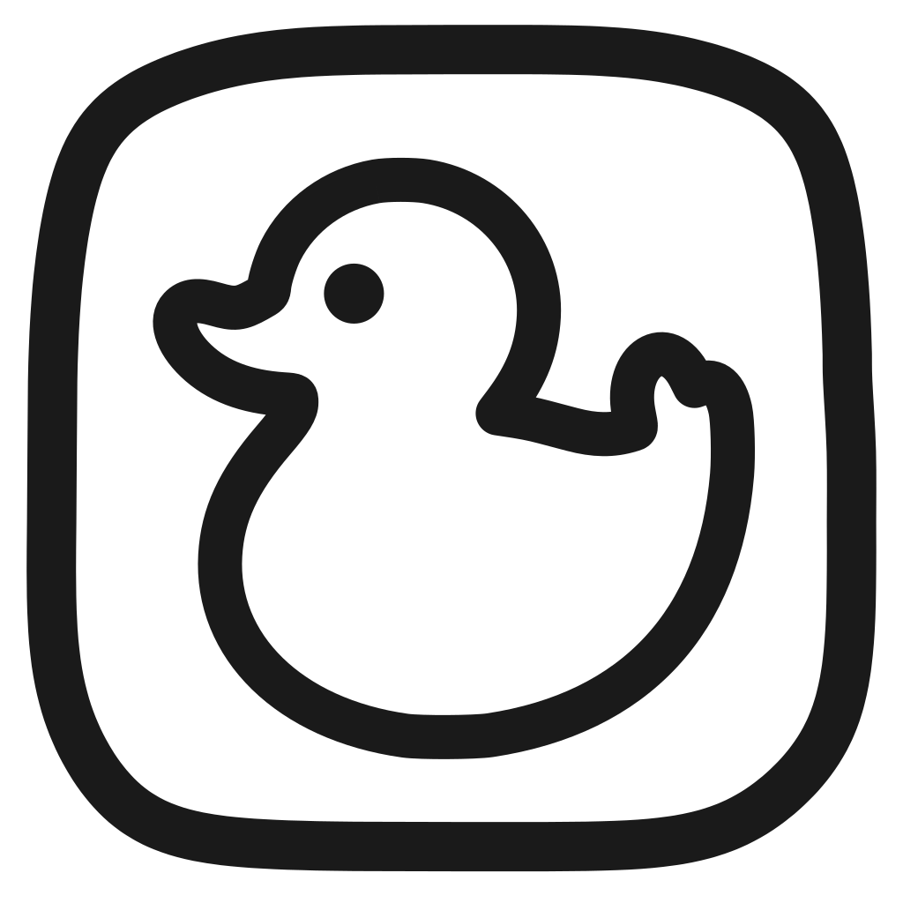
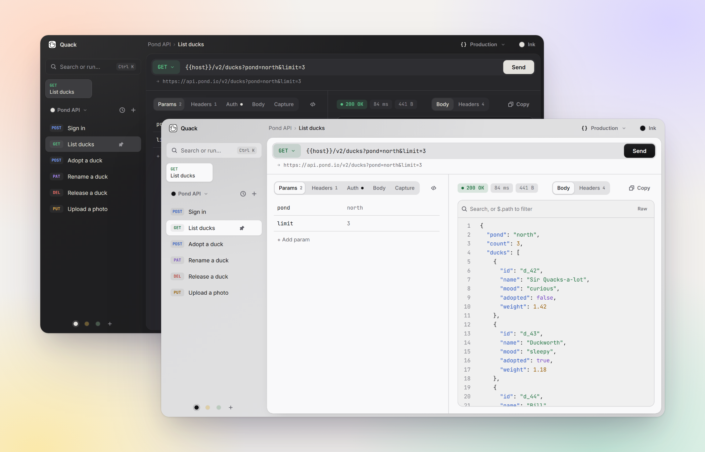
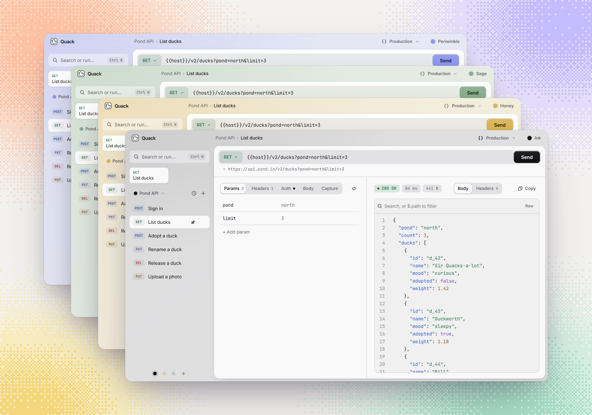

<p align="center">
  
</p>

<h1 align="center">Quack</h1>

<p align="center">
  <b>The API client that minds its own business.</b>
</p>

<p align="center">
  A fast, open source, offline API client for Windows, macOS and Linux.<br>
  No account. No cloud. No telemetry. Your requests, tokens and collections never leave your machine.
</p>

<p align="center">
  <a href="https://github.com/itsmunzir/quack/releases/latest"></a>
  <a href="LICENSE"></a>
  
  
</p>

<p align="center">
  <a href="https://github.com/itsmunzir/quack/releases/latest"><b>Download</b></a>
  &nbsp;·&nbsp;
  <a href="#quiet-by-design">Privacy</a>
  &nbsp;·&nbsp;
  <a href="#your-collection-is-just-files">Git-friendly</a>
  &nbsp;·&nbsp;
  <a href="#coming-from-postman">Coming from Postman</a>
  &nbsp;·&nbsp;
  <a href="#everything-you-need-nothing-you-dont">Features</a>
</p>

<br>

<picture>
  <source media="(prefers-color-scheme: dark)" srcset="docs/screenshot-dark.png">
  
</picture>

<br>

## Quiet by design

API clients tend to start simple and grow a login screen, a sync service and an upsell. Quack is a
desktop app that sends HTTP requests and shows you what comes back. That's the whole job.

- **No account.** Install it, open it, send a request. There's nothing to sign in to.
- **No cloud.** Your spaces live on your machine, or in a folder you choose. There's no server to sync to.
- **No telemetry.** Quack sends the requests you send and nothing else. Its window is locked down by a strict [content security policy](src-tauri/tauri.conf.json) that only lets it talk to the app itself.
- **No surprises.** No plugins installed behind your back, no AI reading your traffic, no requests routed through someone else's servers.
- **No secrets in git.** Mark a variable as secret and its value stays in a gitignored local file.
- **Open source.** MIT licensed. Every line is right here to read.

## Your collection is just files

Save a space to a folder and it becomes plain YAML you can commit, review in a pull request and share
with your team. Quack keeps both sides in step: edits save as you go, and a `git pull` shows up the
moment you switch back to the app.

```
pond-api/
├── quack.yaml               name, theme and request order
├── requests/
│   ├── sign-in.yaml         one small file per request
│   └── list-ducks.yaml
├── environments/
│   └── production.yaml      shared variables; secrets listed by name only
└── local.yaml               your secret values, gitignored
```

```yaml
# requests/list-ducks.yaml
name: List ducks
method: GET
url: "{{host}}/v2/ducks?pond=north&limit=3"
headers:
  - Accept: application/json
auth:
  type: bearer
  token: "{{token}}"
```

Diffs stay small and readable. Tokens typed straight into a request and variables marked with the
lock are written only to `local.yaml`, and Quack adds a `.gitignore` for it when the folder has none.
A teammate who clones the repo gets the same requests and fills in their own secrets.

## Coming from Postman?

Bring your work with you. Open the space menu and choose **Import collection…**

- **Postman** collections (v2 and v2.1, JSON or YAML). Requests inside folders come along, named after their folder, and so does auth.
  Test scripts that save a response value, like `pm.environment.set("token", pm.response.json().token)`, become captures.
- **OpenAPI 3** and **Swagger 2** specs. Every endpoint becomes a request, the server becomes `{{baseUrl}}`,
  path params become variables and example bodies are filled in.
- **`.http` files** from VS Code REST Client or JetBrains. File variables become an environment, and
  response references like `{{login.response.body.$.token}}` become captures, so chains keep working.
- **cURL**. Paste a command into the URL bar and it turns into a request, headers, auth and all.
- **Quack backups** from another machine.

Leaving is just as easy: export any space, back up everything in one file, or copy any request as code.

## Everything you need, nothing you don't

**Requests**
- GET to OPTIONS, with query params edited as rows and kept in sync with the URL
- Bodies as raw text, URL-encoded forms, or multipart with file uploads
- Cancel a slow request mid-flight
- Copy any request as cURL, JavaScript `fetch`, Python `requests`, Go `net/http` or HTTPie, with variables
  filled in, JSON bodies written as real objects and file uploads included
- JSON responses highlighted, with headers, status, timing and size at a glance
- Fold any object or array, search the body (`Ctrl+F`), or type `$.data.items[0]` to see just that part
- Click a key to copy its path, ready for a capture; switch to Raw for the exact text
- Image responses shown as images
- Cookies, redirects and gzip, brotli and zstd decoding handled for you

**Variables and auth**
- Environments per space: write `{{variable}}` in a URL, header, body or auth field
- A preview line under the URL shows exactly where the request will go
- Bearer, Basic and API key (header or query) auth
- Request chaining: capture a token or ID from one response, by JSON path or header, and every other
  request can use it as `{{token}}`. No scripts to write, with a live preview of what each path picks out

**Finding your way**
- Spaces: up to nine collections, each wearing its own theme, one keystroke apart
- Pinned favourites, plus a command bar (`Ctrl+K`) to jump anywhere or run anything
- History per space: every send with its response, one click to see it again

**Looks**
- Four themes, Ink (the default), Honey, Sage and Periwinkle, each in light and dark or following your system
- An optional accent glow, because why not

**Light on your machine**
- A native app built on Tauri and Rust, not Electron
- The Windows installer is about 3 MB

## Every space dresses differently

Give each space its own theme and you'll never fire a request at production thinking it was staging.
Ink is the default. Honey, Sage and Periwinkle are one click away, and every theme comes in light and dark.

<picture>
  <source media="(prefers-color-scheme: dark)" srcset="docs/themes-dark.png">
  
</picture>

## Keyboard first

| Keys | Does |
| --- | --- |
| `Ctrl` `Enter` | Send, or cancel while sending |
| `Ctrl` `K` | Command bar |
| `Ctrl` `N` / `Ctrl` `D` | New / duplicate request |
| `Ctrl` `1`…`9` | Switch space |
| `Ctrl` `E` | Next environment |
| `Ctrl` `H` | History |
| `Ctrl` `F` | Search the response |
| `Ctrl` `Shift` `T` | Next theme for this space |

On macOS, use `Cmd` where it says `Ctrl`.

## Download

Grab the installer for your system from [**Releases**](https://github.com/itsmunzir/quack/releases/latest):

| System | File |
| --- | --- |
| Windows 10 and 11 | `.exe` installer or `.msi` |
| macOS (Apple silicon and Intel) | `.dmg` |
| Linux | `.deb`, `.rpm` or `.AppImage` |

> [!NOTE]
> Builds aren't code-signed yet. On Windows, SmartScreen may warn: choose **More info → Run anyway**.
> On macOS, right-click Quack.app and choose **Open** the first time.

## Build from source

You'll need Node 24+, stable Rust, and on Windows the WebView2 runtime.

```sh
git clone https://github.com/itsmunzir/quack
cd quack
npm install
npm start        # the app, with hot reload
```

<details>
<summary><b>Under the hood</b></summary>

<br>

- **Shell:** [Tauri 2](https://tauri.app) and Rust
- **Interface:** React 19, TypeScript, Tailwind CSS 4, Vite
- **HTTP engine:** [reqwest](https://github.com/seanmonstar/reqwest), in [`src-tauri/src/engine.rs`](src-tauri/src/engine.rs)
- **Folder sync:** the format lives in [`src/folder.ts`](src/folder.ts); the Rust side in [`src-tauri/src/folder.rs`](src-tauri/src/folder.rs) only writes the paths that format allows
- **Themes:** in [`src/styles.css`](src/styles.css). A theme is just an accent colour; light and dark surfaces
  come from the mode and take a faint wash of the accent. To add one, add a `data-theme` block with
  `--accent` and `--accent-fg`, then list it in [`src/themes.ts`](src/themes.ts).

</details>

<details>
<summary><b>Brand</b></summary>

<br>

Logo files live in [`docs/brand`](docs/brand):

- `sticker-mono.svg`: the app icon, a black and white hand-drawn outline
- `sticker-dark.svg` and `sticker-yellow.svg`: alternates
- `duck.svg`: the line duck, for large sizes and the empty state

App icons are generated with `npm run tauri -- icon src-tauri/icons/source.svg`.

</details>

## License

[MIT](LICENSE). Free to use, fork and ship.

<br>

<p align="center">
  <sub>Looking for an open source Postman or Insomnia alternative that works offline, keeps collections in git and never asks you to log in? You found it. 🦆</sub>
</p>
